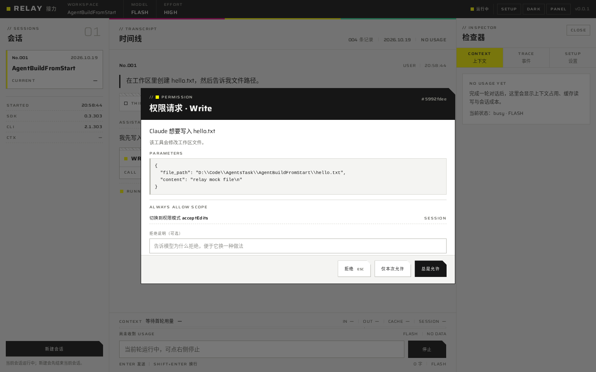
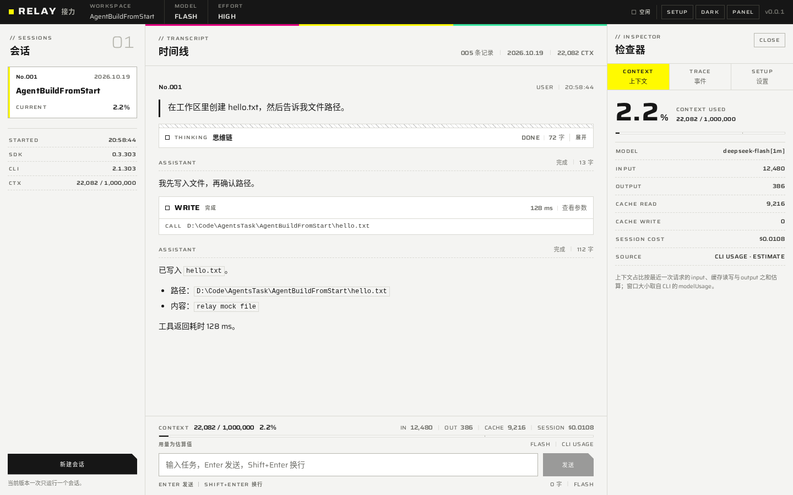
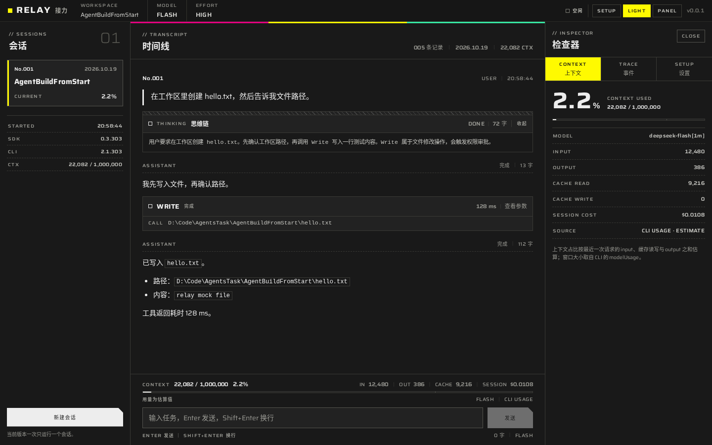
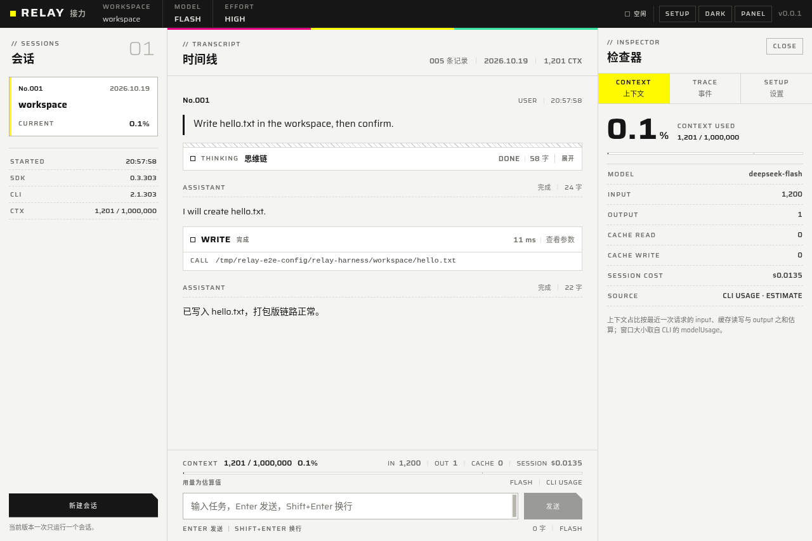

# M0 技术验证报告

日期：2026-10-19 ｜ 对应代码：`relay-harness` 工作区当前提交 ｜ 范围：单会话最小闭环 + 双平台打包布局

---

## 0. 结论速览

| 验证项 | 结果 | 说明 |
| --- | --- | --- |
| electron-vite 单包分层骨架 | 通过 | `src/main` / `src/preload` / `src/renderer` / `src/shared`；主进程 ESM、preload ESM、渲染层无 Node |
| Agent SDK 集成（锁 0.3.303） | 通过 | `query()` 长连接 streaming input；内置 CLI 由 SDK 平台包提供 |
| DeepSeek 端点接入 | 代码通过，真实密钥待测 | `ANTHROPIC_BASE_URL` + `ANTHROPIC_AUTH_TOKEN`；本报告使用本地 Anthropic 兼容 mock 完成闭环 |
| 流式文本 | 通过 | `includePartialMessages` → `text_delta` / `text_done` |
| thinking 折叠块 | 通过 | `thinking_delta` → 折叠块；空思维链显示“该模型未返回思维链” |
| 工具调用卡 | 通过 | 工具名、参数摘要、耗时、输入/输出展开 |
| 权限弹窗 | 通过 | `canUseTool` → IPC → 三态（拒绝 / 本次允许 / 总是允许）；默认焦点在拒绝 |
| usage / 上下文仪表 | 通过 | 1M 窗口、input/output/cache、会话成本、填充率 |
| thinking 回传（工具循环） | 通过 | mock 断言第二轮请求包含上一轮 `thinking` block，未重建历史 |
| 多轮长连接 | 通过 | 同一 `query()` 连续两轮；第三请求携带历史 thinking |
| SDK 原生二进制 asarUnpack | 通过 | Linux / Windows / macOS 三种布局均生成在 `app.asar.unpacked` |
| 打包应用端到端 | 通过（Linux） | 打包后的 app 在 xvfb 中启动，用解包 CLI 访问 mock，真实写出文件 |
| Windows NSIS/portable、macOS dmg | 配置就绪，待目标机出包 | 见 §5；CI 工作流已提供 |
| 真实 DeepSeek key / 长会话 400 | 待测 | 用户稍后提供 API key 后补测 |

---

## 1. 环境与范围

- 构建环境：Ubuntu 22 容器（Node v22.23.2、npm 10.9.8），Electron 44.9.0，electron-vite 6.0.0，electron-builder 26.15.3。
- 目标环境：Windows 11 x64、macOS（arm64/x64）。
- 运行时：`@anthropic-ai/claude-agent-sdk@0.3.303`（内置 CLI 2.1.303）。
- 模型端点：本地 mock（Anthropic Messages 流式协议），**没有使用任何真实 DeepSeek key**；仓库与日志中没有密钥。
- 打包验证使用 Linux 作为构建机，并手动放入对应平台 SDK 包，验证目录结构与路径解析；正式安装包应在目标系统上构建（见 §5）。

---

## 2. 已实现的功能面

- 单包分层：`src/shared` 只放类型与 zod schema；`src/main` 持有运行时、配置与 IPC；`src/preload` 暴露最小 `window.relay`；`src/renderer` 只消费归一化事件。
- `RuntimeAdapter` 接口 + `ClaudeAgentRuntime` 实现，SDK 消息经 `EventNormalizer` 转换为自有 `HarnessEvent`，UI 不识别 SDK 类型。
- 密钥：主进程 `safeStorage` 加密写盘；渲染层永远拿不到明文；系统安全存储不可用时退化为“仅本次运行内存保存”，不落明文。
- DeepSeek 子进程环境：合并 `process.env`，清除环境中的其他 Anthropic 凭证，再写入 `ANTHROPIC_BASE_URL`、`ANTHROPIC_AUTH_TOKEN`、模型与 effort、`CLAUDE_CONFIG_DIR`。
- 会话：主进程生成 UUID 并通过 `options.sessionId` 固定；`resume` 能力在 adapter 中保留，UI 尚未接线（M1）。
- 权限：`permissionMode: default`，`canUseTool` 桥接；窗口关闭时主进程主动 deny，避免工具永久挂起。
- UI：endfield-ui 风味控制台（命令栏、会话轨、时间线、检查器、权限模态），浅色/深色两套，Saira 自托管 + 系统中文黑体。

---

## 3. 验证项与证据

### 3.1 类型检查、构建、单测

```text
npm run typecheck       通过（node + web 两套 tsconfig）
npm run build:app       通过（main 33 KB，preload 1.8 KB，renderer 1.09 MB）
npm test                7 passed
  tests/normalizer.test.ts   3 passed
  tests/binary.test.ts       3 passed
  tests/smoke.sdk.test.ts    1 passed
```

### 3.2 SDK 闭环（本地 mock）

`tests/smoke.sdk.test.ts` 启动本地 Anthropic 兼容 SSE 服务，真实拉起 SDK 内置 CLI，完成一轮带权限的工具调用，再跑第二轮：

- 事件序列包含 `session_started`、`thinking_delta`、`thinking_done`、`text_delta`、`text_done`、`tool_call`、`permission_request`、`tool_result`、`usage`、`turn_end`。
- 权限回调收到 `Write`，返回允许后工具真实执行，`hello.txt` 内容为 mock 写入值。
- `usage` 事件：`contextWindow = 1,000,000`，占比按最近一次请求计算。
- 第二次 API 请求的 `messages` 中同时存在 `thinking` block 与 `tool_result` block —— 证明 CLI transcript 完整回传了思维链。
- 同一 `query()` 继续发送第二条用户消息，第三个请求仍携带历史 thinking block，第二轮正常结束。

### 3.3 打包应用端到端（Linux）

用 `electron-builder --dir --linux` 产出 `release/linux-unpacked`，在 xvfb 中启动 `relay-harness`，通过 CDP 驱动真实界面：

1. 在 SETUP 面板保存本地 mock 的 Base URL 与测试 key；
2. 新建会话，发送任务；
3. 权限弹窗出现，点“仅本次允许”；
4. 工具执行完成，时间线出现 thinking、工具卡与成果；
5. 上下文仪表显示 `1,201 / 1,000,000`、`0.1%`、`SESSION $0.0135`；
6. 工作区真实生成 `hello.txt`，内容 `packaged relay`。

打包后的页面来自 `resources/app.asar/out/renderer/index.html`，CLI 来自 `resources/app.asar.unpacked/.../claude`，说明 asarUnpack 与 `pathToClaudeCodeExecutable` 路径解析有效。

### 3.4 三平台 asarUnpack 布局

| 平台 | 产物目录 | 解包后的 CLI |
| --- | --- | --- |
| Linux x64 | `release/linux-unpacked/resources` | `app.asar.unpacked/node_modules/@anthropic-ai/claude-agent-sdk-linux-x64/claude`（273 MB） |
| Windows x64 | `release/win-unpacked/resources` | `app.asar.unpacked/node_modules/@anthropic-ai/claude-agent-sdk-win32-x64/claude.exe`（277 MB） |
| macOS arm64 | `release/mac-arm64/Relay.app/Contents/Resources` | `app.asar.unpacked/node_modules/@anthropic-ai/claude-agent-sdk-darwin-arm64/claude`（256 MB） |

- Windows 目录构建在 Linux 上完成（electron-builder 26 自带 Windows 资源编辑工具链），`Relay.exe` 正常生成。
- macOS `.app` 目录在 Linux 上完成；dmg 打包、签名与公证需在 macOS 上执行。
- `scripts/verify-package.mjs` 会检查：存在 `app.asar`、存在对应平台 CLI、没有 musl 重复包、CLI 体积合理。`npm run verify:package` 可在打包后直接运行。

### 3.5 密钥存储实测

- Linux 容器没有 keyring：`safeStorage.isEncryptionAvailable()` 为 false，应用按设计退化为内存保存；`settings.json` 中 `apiKey` 为 `null`，没有明文落盘。
- Windows（DPAPI）与 macOS（Keychain）路径已在代码中启用，需在目标机做一次“保存 → 重启 → 会话可用”的确认。

---

## 4. 已知问题与下一步

必须补测（需要真实 DeepSeek key）：

1. 在 SETUP 保存真实 key，发送一个会写文件的任务，确认 thinking 可见、工具审批可用、usage 有数据。
2. 连续多轮带工具调用，确认不会出现 `thinking must be passed back` 400。
3. 在 Windows 上确认 Defender 不误报内置 CLI；安装包可正常启动。
4. 在 macOS 上完成 Developer ID 签名、公证与 Gatekeeper 验证。
5. 确认 Windows DPAPI / macOS Keychain 的密钥在应用重启后可解密。

功能层面留到 M1/M2：

- 会话列表与恢复（`resume` 已有 adapter 支撑，UI 未接）；
- 事件持久化（SQLite）与时间线虚拟滚动；
- 上下文达到阈值后的交接（M2）；当前只显示仪表；
- 断线重连、崩溃恢复、长会话压缩边界处理；
- diff 卡与 Shiki 代码高亮（M1）。

SDK issue #493（Write/Edit 权限绕过）回归：锁定版本 0.3.303 上已确认 `Write` 会经过 `canUseTool`；`Edit` 未单独构造用例，M1 前补一条回归。权限弹窗的“总是允许”被强制限定为 `session` 作用域，避免 CLI 建议把规则写入全局用户设置。

---

## 5. 双平台出包说明

正式安装包在目标系统上构建，npm 会自动安装对应平台的 SDK 原生包：

```bash
# Windows x64
npm ci
npm run dist:win          # NSIS + portable
npm run verify:package

# macOS（在对应架构的机器上）
npm ci
npm run dist:mac          # 当前架构 dmg
npm run verify:package
```

- macOS 签名/公证需要 Developer ID 证书；`electron-builder.yml` 已开启 hardenedRuntime 并提供 entitlements，`notarize: false` 为本地未签名构建保留空间。
- 交叉构建（Linux 出 Windows/macOS 包）不受 npm optionalDependencies 平台过滤支持；本次验证是手动放入对应平台 SDK 包完成的目录级验证，不作为分发流程。
- `.github/workflows/build.yml` 提供 windows-latest + macos-14(arm64) + macos-13(x64) 矩阵：`npm ci → typecheck → test → build → package → verify:package → upload artifact`。

中国网络环境下可先切换镜像：

```bash
npm config set registry https://registry.npmmirror.com
# Windows PowerShell
$env:ELECTRON_MIRROR="https://npmmirror.com/mirrors/electron/"
$env:ELECTRON_BUILDER_BINARIES_MIRROR="https://npmmirror.com/mirrors/electron-builder-binaries/"
```

---

## 6. 复现命令

```bash
npm ci
npm run typecheck
npm test                # 含正常化单测、路径单测、SDK mock 闭环
npm run build:app
npm run dist:dir        # 当前平台未打包目录
npm run verify:package
```

需要真实 key 时：

```bash
npm run dev
# 在右侧 SETUP 保存 key → 新建会话 → 发送任务
```

---

## 7. 截图

权限请求（真实打包界面同款组件）：



完成一轮后的时间线与上下文仪表：



深色主题：



打包应用（Linux asar 版本，真实 SDK CLI 跑通 mock）：


